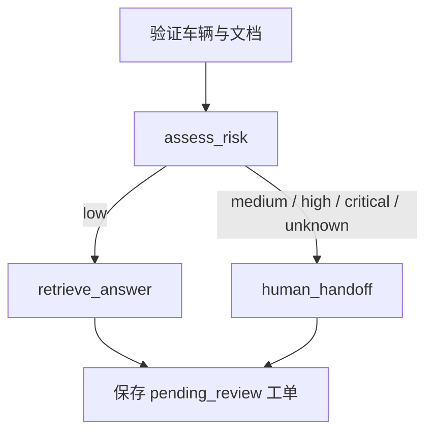

# 售后 Agent 分流与工单

本阶段实际开发日期：2026-10-26。

## 执行流程

`POST /api/v1/agent/triage` 先验证车辆及可选文档，再调用 LangGraph
`StateGraph`。图只计算建议，数据库保存位于图执行完成之后。

图的条件边与编译执行方式采用
[LangGraph 官方 StateGraph API](https://reference.langchain.com/python/langgraph/graph/state)。
当前是固定节点的工作流，不会由模型自行选择任意工具。

## 分流规则

| 风险 | 示例 | 执行分支 |
| --- | --- | --- |
| critical | 冒烟、起火、热失控 | 紧急风险提示并交人工 |
| high | 刹车、转向、高压、碰撞、烧焦味、轮胎失压 | 交人工 |
| medium | 无法充电、故障、异味、部件损坏、明显过热 | 交人工 |
| low | 普通充电、保养、保修、手册问题 | RAG 检索与证据引用 |
| unknown | 未命中已知例行描述 | 交人工 |

按等级从高到低匹配，同一句中有例行词和风险词时采用风险分支。
规则刻意保守：否定句、历史描述、假设性问题中的风险词仍可能转人工。
这是一组可审计的演示规则，未经过真实车辆数据校准，也不能覆盖所有危险
说法、拼写错误或委婉表达。`low` 仅表示命中例行问题规则，不证明车辆安全。
2026-10-27 的症状词扩充与新增集结果见 [`QUALITY_GUARDS.md`](QUALITY_GUARDS.md)。

## RAG、降级与工单状态

- 例行问题沿用 RAG 的证据阈值、来源引用及无证据拒答。
- RAG/向量服务的已知异常返回人工处理提示，并创建待审核工单。
- 未知编程异常正常抛出，图执行失败时不会提前保存半成品工单。
- Agent 创建的工单为 `pending_review`、`requires_human_review=true`。
- `recommended_action` 保存 AI 建议或人工转交提示。
- 新建时 `final_response`、`approved_at`、`closed_at` 均为空；人工审批与关闭规则见
  [`HUMAN_REVIEW.md`](HUMAN_REVIEW.md)，该流程已于 2026-10-27 接通。
- 证据列表和执行路径在分流响应中返回，来源 ID 和图路径摘要保存到 `ai_summary`。
- 工单提交失败会回滚事务，API 返回 `503`；关联实体不存在返回 `404`。
- 每次 POST 新建工单，目前没有幂等键，客户端不要自动重试写请求。

Agent 和普通读取接口限本地开发演示使用。审核接口使用独立密钥保护，
尚未接入生产账号与角色系统，也未实现人员通知或实际派单。

## 本地验收

1. 按 README 安装依赖、迁移数据库、启动 API，打开 `/docs`。
2. 通过车辆 API 创建车辆；通过文档 API 上传并处理资料。
3. 使用真实车辆 ID 请求 `/api/v1/agent/triage`，问题为“给车辆充电之前需要做什么？”。
4. 证据足够时路径含 `assess_risk / retrieve_answer / evidence_found / save_pending_ticket`。
5. 以“电池冒烟了”请求，应走 `human_handoff`，不调用 RAG，不返回证据引用。
6. 查询 `/api/v1/service-tickets/{ticket_id}`，确认持久化建议和待审核状态。

测试使用内存 SQLite 和隔离的 RAG 替身，不修改实际车辆、文档或工单数据。
另已使用本地持久化 Qdrant 的文档 1 验证真实检索分支，命中文本块 1，分数 0.4395。

## Windows 依赖说明

本机应用程序控制策略阻止加载部分新版本扩展，因此 requirements 固定了本机
验证通过、且满足上游依赖范围的 `xxhash 3.6.0`、`mmh3 5.2.0`、
`py-rust-stemmers 0.1.5`。仅调整项目虚拟环境依赖，没有修改操作系统策略。
Embedding 的运行时导入移至模型初始化处，导入失败作为领域异常处理，
让 API 启动、车辆接口和人工分流无需提前加载完整模型栈。
